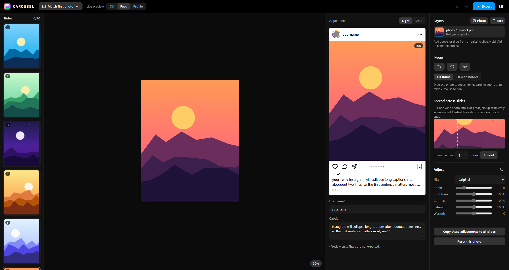
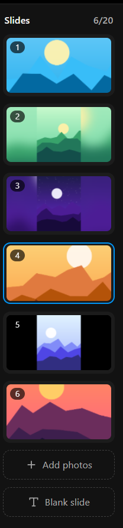
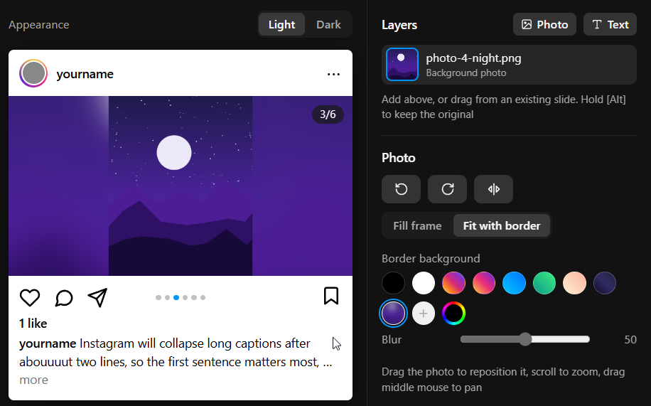
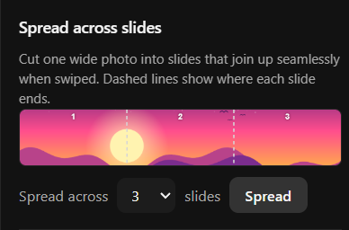

<p align="center">
  
</p>

<p align="center">
  Design and export swipeable photo carousels, fast.
</p>

<p align="center">
  
</p>


## Features

### Build your carousel
Add photos, drag to reorder, and preview the swipe flow as you work.




### Gradient backgrounds
Pick a gradient swatch to give every slide a consistent look.




### Spread across slides
Cut one wide photo into slides that join up seamlessly when swiped.




## Download

Get the latest version from the [Releases page](../../releases/latest).

| Platform | File |
|----------|------|
| Windows  | `.exe` installer |
| macOS    | `.dmg` (Intel and Apple Silicon) |
| Linux    | `.AppImage` |

**Windows:** if SmartScreen warns you, click **More info → Run anyway**.
**macOS:** the app is unsigned. Right-click it and choose **Open**. If macOS says it's damaged, run `xattr -cr "/Applications/Carousel Studio.app"`.


## Build from source

```bash
git clone https://github.com/<your-user>/Carousel.git
cd Carousel
npm install
npm start
```

Requires [Node.js](https://nodejs.org/) 18 or newer.


## License

[MIT](LICENSE)
